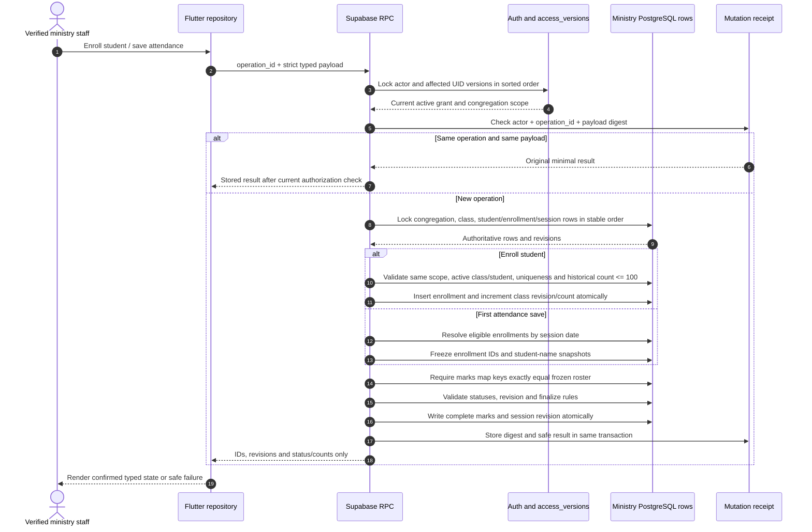

# Enrollment and attendance transaction sequence

<!-- canonical-document-authority -->
> **Historical integration baseline.** The [current spec](../superpowers/specs/2026-10-20-ministry-corrective-release-design.md), [current plan](../superpowers/plans/2026-10-20-ministry-corrective-release-plan.md) and [JSON mirror](../superpowers/plans/2026-10-20-ministry-corrective-release-plan.json) govern current requirements, status, task order and authorization. Retain the original contracts/provenance; use current completion contracts and the task owner to resolve superseded identity, grant and attendance assumptions.

## Ownership sketch

- `MinistryRepository` coordinates typed feature ports and the existing gateway.
- `EnrollmentCommand` owns student/class IDs, congregation, start date and operation ID.
- `AttendanceCommand` owns session ID, expected revision, complete enrollment-keyed marks and finalize flag.
- PostgreSQL owns authorization, roster snapshot, transaction boundaries, revision, timestamps and replay receipt.
- `EnrollmentProgress` is a read projection over finalized, non-canceled session marks; it is not a client-maintained counter.
