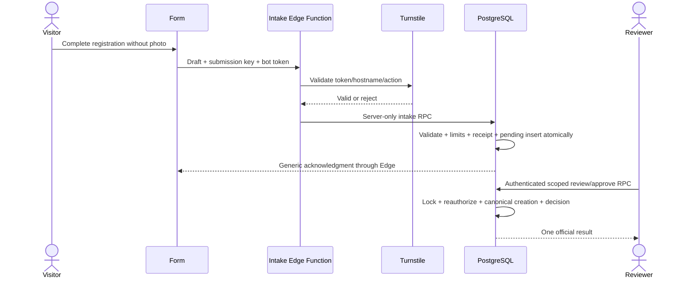

# Public Web Intake and Profile Photos

## Superseding user decision — pre-production, 2026-10-26

The user explicitly clarified that the hosted application/database is NOT in production. After preserving the original launch dataset in a verified recoverable external backup, freely change application data for actual online testing: create/edit/delete backed-up application records, use test identities/grants, apply reviewed migrations, deploy/configure the feature function, and reset/reseed application-owned test state when necessary. Keeping original rows unchanged and cleaning every fixture after every individual test are no longer blockers. Final restoration/reimport of the intended launch dataset is authorized before publication. Do not repeatedly request permission for these covered pre-production operations.

This decision supersedes older production-style restrictions in this Spec, plan, handoff and runbook, including the prohibition on final dataset restoration where no legitimate concurrent production writes exist. It does not authorize deletion of the Supabase project, unrelated targets, blind resets of managed Auth/Storage/system schemas, losing the sole backup, exposing personal data/secrets, paid services or public publication. Preserve actual product RLS/auth/bot protections; use privileged operator access for setup and genuine user roles for behavioral assertions. Missing operator privileges or service configuration are technical prerequisites, not permission refusals.

Before launch, restore/reimport preserved application data into the final migrated schema without reverting feature migrations. Reconcile IDs/links/grants/photos, remove test accounts/data, rerun critical checks, take a fresh launch backup and record the production transition. Preserve required Storage bytes separately (database dumps omit them) and account for Auth identities/configuration. From the transition to real use onward, apply the stricter production safeguards. Plan P1–P6 defines execution.

Status: approved by the user on 2026-10-25. Implementation has since been reported complete on `feat/public-web-intake`; runtime/hosted acceptance remains incomplete. Resume from current evidence rather than restarting implementation. This document defines the increment; inherited plans are evidence and contracts, not work to replay.

## Runtime acceptance clarification — 2026-10-26

No local PostgreSQL server is required. Hosted Supabase supplies the database; local `psql`/`pg_dump` client tools, if needed, are distinct from a database server and may be used without Docker. Use the already agreed backup-first hosted procedure. Existing local SQL PASS entries and hosted INCOMPLETE entries can describe different environments/candidates; reconcile rather than overwrite their evidence.

The current remaining acceptance work includes confirming/applying missing reviewed migrations, deploying the function for controlled testing, backup/connection readiness, trusted-address resolution, safely isolated limits/concurrency coverage and the actual anonymous-to-approved browser journey. Verify each against current state. Do not equate missing local tools with missing product functionality or silently mark hosted checks passed.

For address trust, retain the original Spec rule: if no authoritative source is proven, keep Turnstile and global capacity protections and explicitly report the per-network limiter incomplete. Do not substitute spoofable headers, weaken checks silently or introduce a paid proxy. Any resulting release-criteria change needs a concrete user decision; independent acceptance work continues.

Public site publication remains separately authorized. This clarification defines how to resume acceptance; it does not itself perform or broaden authorization for hosted writes. Follow the existing recorded testing authorization and ask only for a genuinely missing target/secret/access or a necessary live activation decision.

Testing-method amendment requested by the user: Docker is not installed and is not a prerequisite. Local unit/widget/processor tests remain local. Database and integrated browser checks use the existing hosted Supabase with a fresh verified backup, run-owned synthetic records/identities, transaction rollback or exact guarded cleanup, and before/after reconciliation. Reuse the procedure in `docs/verification/2026-10-24-hosted-web-write-smoke.md` and its continuation; never reset the hosted schema, replay the disposable database harness, overwrite real records or restore a whole dump over concurrent writes. Native PostgreSQL restore rehearsal is optional when already available; otherwise report the backup verification limitation. Detailed execution safeguards are in the plan's database-testing amendment. This authorizes the chosen testing method, not site publication or paid services.

## Intent and agreed scope

Publish the unified Flutter application at a public HTTPS address. Anyone can register a new convert without an account, selecting any active congregation. Anonymous submissions require approval before becoming official. Visitors cannot read converts, congregation details, ministry data, reports, or photos. Only congregation IDs and names needed for selection are public.

Other areas require Google login and existing server-enforced permissions. Authorized registrations become official immediately. Anonymous visitors cannot attach photos. Authorized photo users can take a photo or choose one from the gallery, adjust square framing, and save a standardized image that can be enlarged from cards.

Keep the first release small and within free service quotas. No paid services, Redis, SMS, email verification, notifications, new identity system, broad redesign, Android release/signing project, or historical-photo migration. UI stays pt-BR; engineering documents are English.

## Investigation and baseline

On 2026-10-25, live `git ls-remote --heads origin` showed only `main`. After fetch, `origin/main` was `846a320619d3d8240df391a8b218c713bcceedc3` (close web completion plan). The current primary checkout is older (`flutter-supabase`, `c321e81`) and contains unrelated modifications. Do not implement from this checkout or use its README status as current delivery evidence. Prepare execution from the fetched main while preserving existing files.

Owners inspected on main:

- `lib/app.dart`, `lib/routing/router.dart`: bootstrap, authenticated lifetime boundary and route guards; registration currently requires a session.
- `lib/features/converts/register_page.dart`, `convert_form.dart`: registration and shared form; picker explicitly uses `ImageSource.gallery`.
- `lib/domain/models.dart`: existing campaign/congregation and global-manager access predicates.
- `lib/data/convert_repository.dart`, `supabase/migrations/`: official person/convert projections and transactional commands; approval must preserve unified-person, report and weekly invariants, rather than inserting a simplified convert row.
- `lib/features/photos/photo_processor.dart`: orientation correction, center crop to 192x192, JPEG quality 90, metadata stripping, input limits of 20 MiB and 24 megapixels.
- `photo_repository.dart`, `convert_card.dart`: private authenticated Storage, 1 MiB compatibility ceiling, existing enlarged display and circular 80px avatar.
- Base44 `PhotoUpload.jsx`: same automatic 192x192 center crop, JPEG quality 0.9, mobile capture hint; no manual crop. `ConvertCard.jsx` already offered enlargement.

No new execution or hosted acceptance is claimed by this design investigation. Main contains later acceptance work; implementation must inspect its current closure evidence before selecting release checks.

Planning investigation addendum: `202610190002_ministry_student_registration.sql` currently permits an authenticated registrar to create an official convert in any active congregation. Therefore client routing alone cannot implement the approved distinction: the new migration must restrict direct official creation to existing scoped/global authority. The current web validation report records 572/572 tests, analyzer/build and hosted authorization/photo evidence for its prior candidate; these are inherited evidence, not fresh passes for this increment.

## Skill classification and coverage

Size: project. Overlays were read progressively as the scope became concrete, rather than loaded as a single initial checklist. `cloud-deploy` covers free managed services, responsibility, resilience and versioned configuration; `quality-gate` covers Done, SQA/SQC and cost/metrics; `design-oo-ux` covers composition, sequence UML, UP gates, framing fidelity and interaction acceptance; `verification-test` covers case design, RED scaffolds and regression; `coding-standards` covers typed modules, validation, pure processing and explicit state ownership; `a11y-ethics` covers POUR, heuristic findings and privacy. No Scrum transformation or ceremony/backlog system was requested, so `agile-loop` is not applicable. The plan carries the requirement-to-task matrix.

The coding brief uses Entry (bounded typed request), Process (pure validation or guarded transaction), Exit (typed safe result), with local initialized variables, no recursive processing, and no mutable globals. Accessibility review records navigation/legibility/feedback findings by severity, checks completion/errors/time and a short user impression without adding telemetry, and states which real assistive-technology checks were executed. No personalization, gamification or algorithmic approval is introduced; retain user choice, camera consent and transparent pending status.

## Approaches considered

1. Require Google login: simpler attribution, but conflicts with the agreed friction-free anonymous path; rejected.
2. Accept anonymous registrations directly: fewer screens, but allows unreviewed data into official records; rejected.
3. Anonymous pending queue, free bot check and basic limits, scoped approval: chosen direction in conversation. Use existing Supabase and existing static-host conventions; no external rate-limit datastore. This does not promise resistance to a sustained distributed attack.

## Proposed defaults requiring approval with this document

These are the author's implementation choices, not prior user statements:

- A logged-in account without congregation/global authority uses the pending route too. Signing in alone never bypasses approval or permits photos. An authorized local user can register directly for their own scope; an out-of-scope congregation uses pending intake without a photo. Global managers can register directly for any active congregation.
- Reviewers can correct form fields before approving, reject, and see pending items; no bulk approvals or separate draft-edit feature. Reassignment is outside v1; reject and resubmit to correct a congregation. Local reviewers must have the existing campaign congregation permission; global managers review all. Ministry access alone does not grant review authority.
- Anonymous congregation selection is required. Approved attribution records the reviewer as the authenticated creator and separately preserves anonymous source/submission ID; never invent an anonymous user identity.
- No submitter contact fields beyond the existing convert form. No public tracking page or public duplicate lookup.
- Initial limits: 20 accepted pending submissions per trusted network hash per rolling hour, 200 per rolling day, and 1,000 pending globally. All are operator-configurable. These are starting values, not measured traffic requirements; church Wi-Fi may require tuning. No browser fingerprinting.
- Pending records expire after 30 days; rejected payloads are erased immediately; approved pending payloads are erased after promotion. Minimal decision metadata is retained 90 days. Show the expiry policy to reviewers.

## Public flow and boundaries

`/` opens public registration; `/register` remains directly usable without login. Preserve existing desktop/sidebar and mobile navigation patterns. Selecting any other destination starts Google login, then applies existing permissions. Unauthorized destinations never load protected repositories. Sign-out returns to registration and clears protected state and photos.

Reuse the existing registration field contract, validation, canonical dates/phones and required cues, excluding photos and requiring an active congregation. Never broaden anonymous access to existing congregation or convert tables. A dedicated names-only catalog endpoint exposes active UUID/name pairs in bounded pages, cached during the form session; do not query on every keystroke. The submission endpoint independently validates the congregation.

Anonymous success means “Submitted for congregation review,” not “Official registration saved.” Return only a generic acceptance outcome; no person data, duplicate status or official IDs. Validation/rate-limit/unavailable failures keep the form filled. Clear personal form data only after acknowledged acceptance; keep it in memory, not localStorage.

## Minimal intake backend

Use one Supabase Edge Function for anonymous intake, with JWT verification disabled only for this intentionally public function. Other existing APIs retain authentication. Validate a strict request allowlist, payload size (16 KiB), current hostname/action and a fresh Turnstile token server-side before database persistence. Tokens are not stored or logged. Reject photo bytes, asset references, status fields and actor IDs.

The function derives a network hash using an HMAC secret and a provider-authenticated client address. Never trust an arbitrary caller-supplied forwarding header. Confirm the hosted gateway's authoritative address source before implementation; if it cannot be established, retain global capacity and Turnstile checks and report the per-network limiter as blocked rather than silently trusting spoofable input. Do not retain raw addresses or log personal payloads. An IP is a coarse abuse signal, not a person identity.

A narrowly granted server-only intake RPC atomically validates inputs, checks pause/capacity/rate counters, inserts one pending item and registers an idempotency receipt. Anonymous/authenticated clients have no direct insert/read/update privileges on pending tables or this RPC. Keep server credentials only in Edge Function secrets; use a dedicated least-privilege server role if supported by the existing deployment, otherwise constrain the server-held service credential to this function and fixed RPC calls. No arbitrary table or command forwarding.

Client UUID submission keys survive retries while the form is open. Receipts bind key to canonical payload digest: same key/payload returns the same safe acknowledgment, changed payload conflicts. A replay never consumes another queue slot. Retry after a lost response requires a new Turnstile token but retains the submission key. A new key is created after confirmed success. No public existence oracle.

Store pending data separately from official `people`/`converts`. PostgreSQL RLS/RPC restricts list/detail/approve/reject to the reviewer scope. Review list is paginated at 50, maximum 100, with pending count and oldest-first ordering. Approval locks the pending row, rechecks current grants and active congregation, validates corrected fields and runs the canonical unified person/convert creation logic in the same transaction. It records the official ID and decision once. Concurrent/repeated approvals return the authorized prior result, never create duplicates. Rejected/expired items cannot be approved. Rollback leaves the item pending and all official counters unchanged.

No matching or merging by name. For v1, reviewers use existing scoped official search if they suspect duplicates; an automated duplicate-review feature is outside scope. Counter/payload retention cleanup is bounded and piggybacks on intake/reviewer operations, with a documented manual maintenance command; no new scheduler service. Expired entries never count toward active capacity or appear as actionable.

## Photo increment

Reuse private photo Storage and the existing processing repository. Both camera and gallery pass through one crop-confirmation step: fixed 1:1 viewport, pan/zoom, circular guide matching cards, confirm/cancel/reset. Do not stretch images or crop off-center without a preview. Cancel keeps the previous photo and form values.

New photos are orientation-corrected, cropped and encoded as exactly 512x512 JPEG. Target roughly 100 KiB; hard output limit 200 KiB. Reduce JPEG quality in bounded steps without changing dimensions; if the limit cannot be met, show a recoverable error. Keep current 20 MiB/24MP input guards and metadata stripping. Keep the server's existing 1 MiB compatibility ceiling for old photos; 200 KiB is the new processing-output contract, not a claimed new universal Storage policy. No original image is uploaded. Old 192px photos remain readable and are upgraded only on replacement.

Camera capture uses the existing image-picker platform implementation, not a custom camera stack. Mobile web behavior depends on browser/device support; offer gallery fallback and clear permission/error handling. No permission request before choosing camera. Existing enlargement is reused and adapted only as needed to display the new square without stretching. No anonymous uploads, draft objects or private photo downloads; server permissions enforce this independently of hidden buttons.

## Structure and one UML sequence

Compose typed `PublicIntakeRepository` (catalog/submit) and `PendingSubmissionRepository` (scoped review/approve/reject) beside existing repositories. Separate public form ownership from authenticated cache/session ownership. Use immutable typed drafts/results, bounded inputs and explicit failure codes; keep image geometry/encoding pure, network calls in adapters, and no mutable global application state.

Sequence UML is selected because the trust and transaction order is the primary architectural risk:

UP conception gate: user approval of scope, permissions, defaults and free-tier tradeoffs. Elaboration gate: prove canonical creation reuse, authoritative network-address handling and public/private separation before dependent UI tasks. Fidelity ladder: existing layout and disposable photo wireframe first, working crop/review prototype during implementation, then actual mobile-web acceptance. Preview: `work/previews/profile-photo-framing.html`; illustrative only, no camera integration or product evidence.

## UX, accessibility and form decisions

Apply blur/submit validation and revalidation after correction, inline errors for every invalid field, visible required/format cues, existing masks/canonical values and existing date-entry behavior. Preserve unchanged legacy fields when editing existing official records; public submissions have no legacy values. Apply explicit pending-success and approval-error feedback; no misleading save confirmation. Reviewer edits obey the same server contract. No new autofill scheme, numbering plan or form redesign.

POUR acceptance: keyboard-accessible form, review controls and crop zoom/position alternatives; meaningful screen-reader labels/status; no color-only status; usable at 360/768/1440px and 200% text; maintain contrast and focus return on closing crop/enlargement. Immediate pointer feedback; pan tracks 1:1 from grab position; any transition is interruptible from its displayed state. Use the existing gesture component's bounded movement, spring settling and velocity handling if provided; no custom momentum/decoration project. Honor reduced motion with static transitions, contrast and reduced-transparency preferences. These criteria apply to the new surfaces, not a whole-app restyle.

## Free hosting, service mapping and operations

Choose managed PaaS/BaaS plus static hosting over self-managed VMs: reuse Supabase Free (Postgres/Auth/private object Storage/serverless Edge Function) and the existing Cloudflare Pages convention. No VM/load balancer/geo-replication/IaC platform purchase. Use a free provider subdomain initially; buying a domain is outside scope. Turnstile Free is the sole new external account configuration. Verify actual current host configuration before deciding whether deployment setup already exists.

Shared responsibility: providers operate infrastructure; operator owns secrets, grants, backups, restore, allowed origins, quota monitoring and account recovery. HTTPS required; use provider at-rest encryption and private buckets; no secret build defines. IaC is limited to versioned SQL migrations, function source/configuration, exact static-route rules and an operator configuration checklist; secret values stay outside git.

No paid SLA/redundancy/automatic disaster recovery is promised. Existing backup/restore runbooks are reused and checked against the final schema; include pending tables/counters or explicitly document their rebuild/expiry behavior. Bot-service failure fails closed for anonymous submissions while authorized existing workflows remain usable. DB outage keeps form values and permits safe retry. Free quota exhaustion may interrupt service; do not enable billing automatically. Rate limits inside an Edge Function reduce database writes, not function invocation consumption. Provide pause/unpause and quota-inspection steps.

Public sources checked 2026-10-25: [Turnstile Free](https://developers.cloudflare.com/turnstile/plans/), [server validation](https://developers.cloudflare.com/turnstile/get-started/server-side-validation/), [Supabase function quota](https://supabase.com/docs/guides/functions/pricing/), [web capture limitations](https://pub.dev/packages/image_picker_for_web). Free quotas are constraints, not unlimited abuse protection.

## Definition of Done and SDD handoff

SQA: approved scope/permission matrix, threat boundaries, reviewed migrations, reproducible configuration and task ownership. SQC: executed SQL/function/widget/browser/photo checks. Prevention is concentrated on authorization, queue abuse and atomic approval; appraisal on these boundaries and one real phone; avoid expanding into enterprise operations. Quality criteria map to functional suitability, security, reliability, usability and maintainability, not an ISO certification claim.

Acceptance requires anonymous registration without login; names-only congregation catalog; no direct queue/official/photo access; Turnstile failure/replay/expiry handling; exact limiter boundaries and concurrency; idempotent retry; cross-congregation denial; grant revocation during review; double-approval race; official report isolation until approval; authorized immediate registration regression; photo source/cancel/crop/dimensions/bytes/metadata; protected-route/login/logout regressions. Include existing appropriate analysis/tests, configured web build and actual hosted mobile Chrome plus iOS Safari smoke when devices are available. Unavailable devices/services are explicit incomplete evidence, not assumed passes.

Use GQM-sized metrics: accepted/rejected/throttled intake counts without PII, pending age/count, duplicate official results under replay (must be zero), authorization leakage (must be zero), photo dimensions/bytes, and executed check outcomes. Static review covers grants/secrets/routes; dynamic checks cover submission/approval/browser behavior. No analytics service required.

After approval, invoke writing-plans. Produce bounded tasks with exact files/contracts, prerequisites, acceptance, meaningful RED cases and verification commands. Smaller-model implementer investigates each owner before edits; independent review checks both spec and code. Do not rerun historical feature plans. Controlled hosted tests follow the user's testing-method amendment above. Public site publication, paid services and unrelated production changes still require separate authorization; this documentation update does not itself execute hosted changes.
