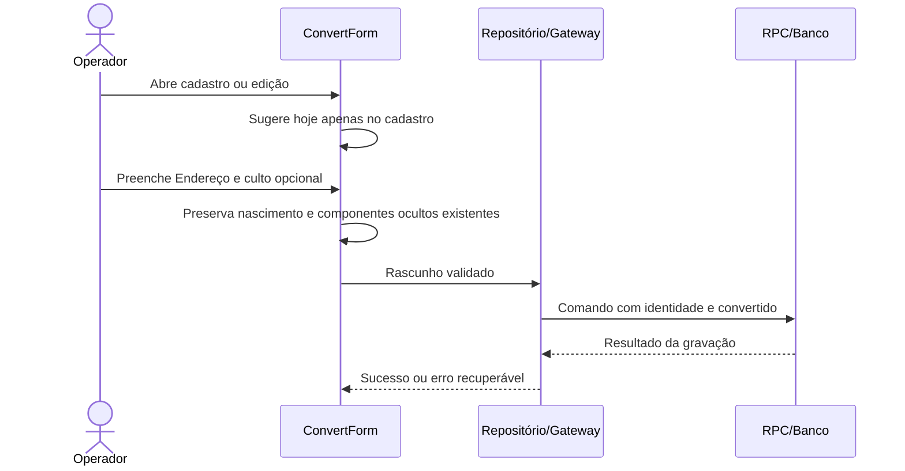

# Simplificação do cadastro de novos convertidos

Data: 2026-10-27. Status: desenho para aprovação; implementação não iniciada.

## Intenção e escopo

Simplificar o formulário de convertidos, preservando os dados pessoais compartilhados com o discipulado. Aplicar a apresentação simplificada tanto no cadastro quanto na edição de convertidos. Não modificar a apresentação do cadastro de alunos, excluir dados históricos ou alterar regras de acesso. A abrangência da edição é uma proposta técnica para evitar perda de dados e manter o mesmo formulário coerente.

## Abordagens

1. **Escolhida pelo usuário:** manter a estrutura do endereço; o campo Endereço altera somente `street` (Logradouro). Novos registros deixam os demais componentes vazios; registros existentes preservam bairro, cidade, CEP e UF. Evita migração do endereço e mantém compatibilidade com o discipulado.
2. Consolidar os componentes antigos em Logradouro e esvaziar os campos separados. Não escolhida: exigiria migração e perderia a estrutura utilizada pelo discipulado.

## Comportamento e contratos

- Remover Data de nascimento do formulário de convertidos. Novos cadastros enviam ausência de nascimento; edições preservam o valor existente. Manter `ministry_people.birth_date` e seu uso pelo discipulado.
- Substituir Logradouro, Bairro, Cidade, CEP e UF por um único campo Endereço, sem torná-lo obrigatório. Gravar esse texto em `person.address.street`. Na edição preservar os demais componentes, inclusive a distinção existente entre endereço ausente e objeto preenchido. Manter compatibilidade com registros legados sem identidade canônica.
- No novo cadastro, sugerir a data corrente de `BusinessCalendar`, no fuso America/Sao_Paulo, ao iniciar o formulário. Permitir alteração pelo controle atual; continuar exigindo uma data válida não futura. Na edição manter a data registrada. Reiniciar o cadastro após sucesso deve calcular novamente a data corrente.
- Tipo de culto fica opcional. Proposta técnica: representar ausência por `null`, reservando “Não informado” à apresentação. Ajustar a nulabilidade da coluna e as validações dos comandos, mantendo a rejeição de textos inválidos quando um valor for fornecido. Preservar valores existentes.
- Atualizar modelos, validações do gateway, decodificação, cartões, relatórios e backup/importação para aceitar ausência de culto de ponta a ponta. Não fabricar uma categoria de culto no banco. Preservar a compatibilidade dos backups anteriores.

## Limites e fluxo (design-oo-ux)

Reutilizar composição: `ConvertForm` possui controles e rascunho; `ConvertDraft` produz o contrato; controlador/repositório/gateway transportam e validam; RPC persiste; `PersonFields` continua atendendo o discipulado sem remover globalmente seus campos. Nenhuma nova hierarquia ou dependência é necessária.

Um diagrama UML de sequência é suficiente para explicitar o ponto de preservação dos campos compartilhados:

Gate UP: concepção concluída com a escolha da abordagem; elaboração termina ao confirmar contratos afetados e compatibilidade da migração. Fidelidade: descrição textual nesta etapa, formulário real na implementação e verificação integrada depois; nenhum protótipo separado é necessário para esta proposta.

## Decisões de formulário e acessibilidade propostas

| Critério | Decisão |
|---|---|
| Validação de entrada | Adaptar as validações existentes às quatro mudanças; manter mensagens por campo e validação no envio. Alterar globalmente o momento da validação fica adiado. |
| Obrigatoriedade e formato | Aplicar: retirar o indicador obrigatório do culto; manter data obrigatória e rótulos claros. |
| Máscaras e valor canônico | Adaptar: manter formatos existentes de telefone e data; endereço é texto livre e culto ausente é nulo. |
| Controle de data | Manter o calendário e a formatação existentes, acrescentando apenas a sugestão inicial. |
| Legado | Aplicar: preservar nascimento, componentes ocultos, dados de endereço ausentes e valores antigos de culto. |
| Retorno e preenchimento automático | Aplicar: sugestão de hoje; manter mensagens de sucesso/erro e preservação do rascunho em falhas. |

POUR: rótulos e erros perceptíveis por leitor de tela; percurso de teclado coerente após a remoção; ausência de campos ocultos focáveis; indicação compreensível de culto opcional; manter contraste, ampliação de texto e semântica dos controles existentes. Preservar resposta imediata dos controles e preferências de redução de movimento/contraste. Não introduzir gestos ou animações: rastreamento 1:1, molas, momentum e interrupção de novas transições não se aplicam a esta mudança.

## Verificação prevista

Cobrir cadastro sem nascimento e sem culto; sugestão de hoje no fuso de negócio, inclusive na virada do dia; alteração manual da data; edição preservando data, nascimento e componentes ocultos; endereço canônico e legado; gravação e leitura de culto nulo; exibição e relatório em “Não informado”; backup/importação com culto ausente e com valores antigos. Confirmar que alterar Endereço reflete em Logradouro no discipulado sem apagar os demais componentes. Validar migração sobre a estrutura existente, além das regressões pertinentes. Nenhum teste foi executado nesta etapa documental.

## Dependências e autorização

Investigação local em `discipulado-IEADPE`, branch `main`, inicialmente limpa, com HEAD observado `846a320`. O diretório inicial `App discipulado` contém planejamento; a implementação está neste repositório.

| Dependência | Estado/evidência | Fase necessária |
|---|---|---|
| Código e migrações locais | Leitura verificada nesta sessão | Desenho e implementação local |
| Banco hospedado e permissões de migração | Não verificados nesta sessão; esquema inferido das migrações locais | Verificação de acesso efetivo antes da execução dependente |
| Ativação no ambiente hospedado | Não autorizada por esta conversa; manter os limites do desenho vigente | Execução externa posterior |

A primeira tarefa de execução deverá verificar os recursos efetivamente necessários e o alvo, sem expor segredos. A falta de acesso remoto não bloqueia implementação e verificações locais independentes. Este desenho complementa o desenho vigente apenas no escopo do formulário de convertidos; não substitui os protocolos de execução e publicação existentes. Nenhuma alteração no banco remoto foi realizada.

## Próximo passo

Após aprovação deste documento, carregar `superpowers:writing-plans` e preparar o plano de implementação. Sem implementação ou migração antes dessa aprovação.
